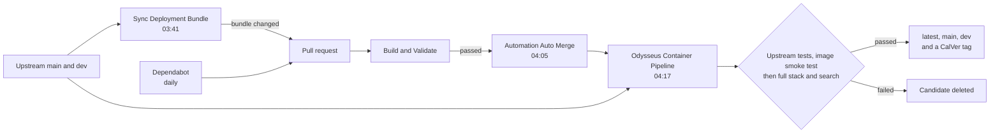

<p align="center">
  
</p>

<p align="center">
  <a href="https://github.com/netspeedy/odysseusai/actions/workflows/build-image.yml"></a>
  <a href="https://github.com/netspeedy/odysseusai/actions/workflows/build-and-validate.yml"></a>
  <a href="https://github.com/netspeedy/odysseusai/pkgs/container/odysseusai"></a>
  <a href="#image-tags"></a>
  <a href="https://github.com/odysseus-dev/odysseus"></a>
  <a href="LICENSE"></a>
</p>

---

This repository publishes container images of [Odysseus](https://odysseus-dev.github.io/odysseus), the self-hosted AI workspace, together with the Compose files that run them. Upstream publishes images of its own these days. These are built from the same source with a couple of packaging fixes applied, so web search works properly in a container deployment and GPT-5 models keep image attachments. You also get immutable CalVer tags to pin, and every tag has booted the complete stack and answered a real search before it was published.

Each night the pipeline checks upstream `main` and `dev` and rebuilds whichever has moved, or whose base image has. A candidate image is smoke-tested on its own, then started with ChromaDB, SearXNG and ntfy and made to answer a SearXNG query through the Odysseus API. Only then do any tags point at it. Upstream changes to the Compose files come in as a pull request that is validated before it merges. This is an independent packaging project, not maintained by or affiliated with the Odysseus project. Application bugs and features belong [upstream](https://github.com/odysseus-dev/odysseus); image and bundle problems belong here.

**Quick links:** [Deploy](#deploy) · [Try it](#try-it) · [Image tags](#image-tags) · [How it works](#how-it-works) · [Package on GHCR](https://github.com/netspeedy/odysseusai/pkgs/container/odysseusai) · [Upstream Odysseus](https://github.com/odysseus-dev/odysseus)

## Deploy

You need Docker with the Compose plugin. Clone the bundle, copy the environment template and start it:

```bash
git clone https://github.com/netspeedy/odysseusai.git
cd odysseusai
cp .env.example .env
docker compose up -d
```

If you'd rather not clone, the base deployment is five files:

```bash
mkdir -p odysseusai/config/searxng odysseusai/scripts && cd odysseusai
base=https://raw.githubusercontent.com/netspeedy/odysseusai/main
curl -fsSLO "$base/docker-compose.yml"
curl -fsSL "$base/.env.example" -o .env
curl -fsSL "$base/config/searxng/settings.yml" -o config/searxng/settings.yml
curl -fsSL "$base/config/searxng/limiter.toml" -o config/searxng/limiter.toml
curl -fsSL "$base/scripts/migrate_searxng_settings.py" -o scripts/migrate_searxng_settings.py
docker compose up -d
```

Open `http://localhost:7011` once the containers report healthy. On first start Odysseus generates an administrator password and prints it to its log, which `docker compose logs odysseus` will show you. Data and logs go to `data/` and `logs/` beside the Compose file. Ports, model-provider keys and optional integrations are set in `.env`, which is upstream's own template with two packaging settings added at the top.

GPU passthrough, host Docker access, host networking and host workspace mounts are opt-in overlays in `docker/`. Enable one by setting `COMPOSE_FILE` in `.env`, for example `COMPOSE_FILE=docker-compose.yml:docker/gpu.nvidia.yml`. The comments in `.env.example` cover each variant and what it grants.

## Try it

The image records the CalVer tag it was published under and the upstream commit it was built from, so you can check what you're about to run without pulling it:

```bash
docker buildx imagetools inspect ghcr.io/netspeedy/odysseusai:latest \
  --format '{{ index .Image.Config.Labels "org.opencontainers.image.version" }} {{ index .Image.Config.Labels "org.opencontainers.image.revision" }}'
```

```text
2026.11.04.1 9d0d3720f4ca181d87bef94da826d730acc6d483
```

The `io.netspeedy.odysseus.*` labels go further: the packaging patches and dependency pins applied to that build, their fingerprints, and the digest of the Python base image.

## Image tags

| Tag | Built from | Use it for |
| --- | --- | --- |
| `latest`, `main` | upstream `main` | The stable channel, and what the Compose file uses by default |
| `dev` | upstream `dev` | The newest upstream changes, gated the same way |
| `YYYY.MM.DD.N` | upstream `main` | Pinning one stable build |
| `YYYY.MM.DD.N-dev` | upstream `dev` | Pinning one development build |

The date is the UTC day the image was published, and `N` counts up from 1 when more than one image goes out that day. To follow `dev` or pin a build, set `ODYSSEUS_IMAGE_TAG` in `.env`. Images are `linux/amd64` only for now.

## Updating

```bash
docker compose pull
docker compose up -d --force-recreate
```

`latest`, `main` and `dev` always point at the newest image that passed its gates, so a pull is all an image update needs. If you deployed from a clone, `git pull` first to pick up upstream's changes to the Compose files. Upstream moved the default host port from 7000 to 7011 in September 2026, so set `APP_PORT=7000` in `.env` if you want to keep the old address.

## What the packaging changes

Nothing here forks Odysseus. The pipeline clones upstream, applies a short list of public changes to the temporary build context, and builds. Right now that list is:

- `0001-searxng-compose-compatibility.patch`, which sends Odysseus's pinned search engines to SearXNG without a category (SearXNG otherwise adds every engine in that category back in), stops it retrying with the default engines that container deployments get rate-limited or CAPTCHA-blocked on, and marks its requests as local
- `0002-gpt5-vision-detection.patch`, which tells Odysseus that GPT-5-family chat models accept images, so attachments aren't dropped on OpenAI-compatible providers
- `mcp<2`, a dependency pin that keeps the bundled MCP 1.x servers working; upstream carries the same pin today

Each one is fingerprinted in the image labels, and a change to any of them triggers a rebuild. Before every build, upstream's own tests for the code the patches touch run with the patches applied, so a patch that changes behaviour an upstream test asserts has to update that test as well. On the Compose side, the sync swaps upstream's image for this one, sets `SEARXNG_GENERAL_ENGINES` to `bing,duckduckgo`, which pass the search smoke test from CI, and removes optional SearXNG engines that fail at startup without Tor or outbound access. It also migrates an existing SearXNG volume to that profile while keeping its secret key. SearXNG, ChromaDB and ntfy are pinned by tag and digest. Upstream doesn't keep those pins current, so Dependabot does it here, and the sync keeps whichever of ours and upstream's is newer.

## How it works

Four workflows and Dependabot do the work, and none of them needs a person in the loop unless something fails.



Sync Deployment Bundle applies the packaging overrides to upstream's Compose files, validates every overlay combination, and boots SearXNG for a real query. It does that in a job with no write access, because it runs upstream's configuration. If anything changed, a second job opens a pull request listing the upstream commit, the changed files and any image pin changes. Build and Validate runs on that pull request and on every other one: it lints the workflows and scripts, runs the pipeline's unit tests, checks that every patch still applies to upstream `main` and `dev` and that upstream's tests for the patched code still pass, and repeats the bundle checks before booting the whole stack with the published stable image. Automation Auto Merge merges the pull request once it passes, which starts an image run against the new bundle.

Dependabot checks every pin this repository owns each day: the SearXNG, ChromaDB and ntfy images in the Compose file, the GitHub Actions the workflows use, and the actionlint image in `scripts/actionlint/`. Its pull requests go through Build and Validate and Automation Auto Merge like the sync's. Upstream's Compose pins aren't kept current, so when the sync regenerates `docker-compose.yml` it keeps any of our pins that is newer than upstream's, and takes upstream's when that is newer.

Odysseus Container Pipeline starts each channel that needs a build by running upstream's tests for the patched code, the test files a patch edits or that import a module it edits. It then builds a candidate, pushes it by digest only, and runs it through the image and Compose gates. A candidate that fails is deleted, and nothing moves. One that passes is promoted to its channel and CalVer tags, and the published labels are verified against what was built.

## Development

The workflows are in `.github/workflows/` and the scripts they call are in `.github/scripts/`. The pipeline's unit tests only need the standard library:

```bash
make test
```

`.github/scripts/validate-bundle.sh` and `.github/scripts/smoke-test-searxng.sh` run the bundle checks locally with Docker, and `make actionlint` lints the workflows with the same pinned actionlint CI uses. To try a sync, clone upstream next to this repository and run `.github/scripts/sync-upstream-runtime.sh ../odysseus .`. To run upstream's tests against the patches, apply them to that clone with `python3 .github/scripts/image_pipeline.py prepare --source ../odysseus --constraints .github/constraints/requirements.txt --patches .github/patches`, then run `.github/scripts/test-upstream.sh ../odysseus`, which needs uv.

The banner at the top of this README is generated. Edit `scripts/readme/build_readme_hero.py` rather than the SVG, and rebuild it with `make readme-hero`. That runs the script with `uv`, which installs the pinned fontTools it subsets the fonts with, and the first run needs network access to download the fonts from assets.netspeedy.io. The same script draws the repository's social preview card, and `make social-card` renders the PNG to upload in the repository settings.

## License

Odysseus is licensed under AGPL-3.0-or-later, and its license is included in `LICENSE`.
